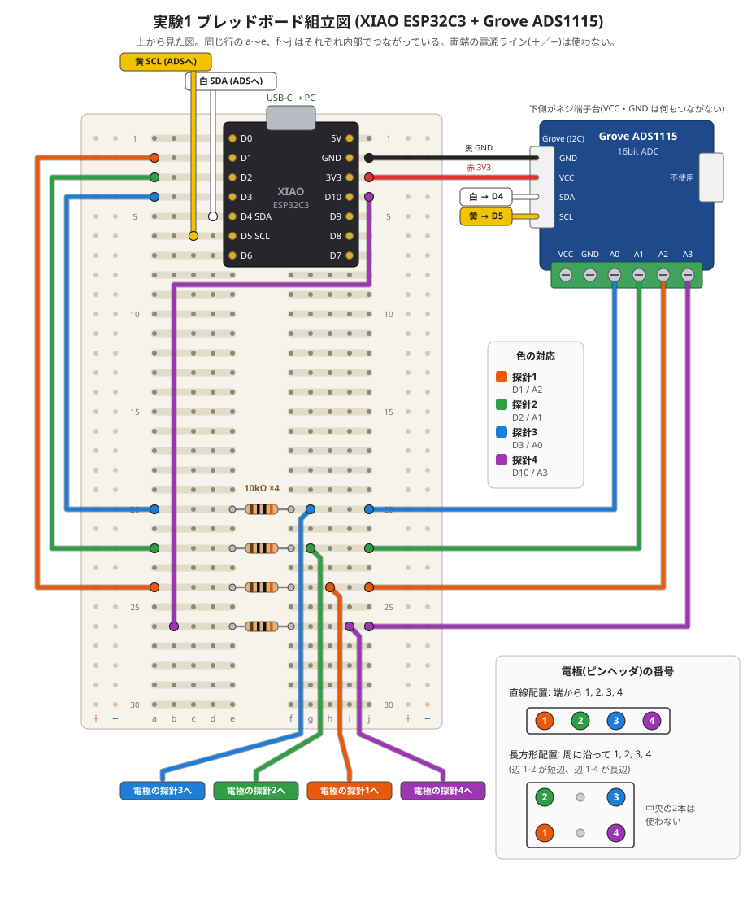

# 実験 1: 4探針法の成立性確認

目的: 厚みの分かっている土の板で R_alpha / R_beta を測り、理論曲線に乗るかを確かめる。

**電極は長方形配置を優先する。** 第一候補は 7.62 × 2.54 mm(比 21.9 → 39.9)、比較用に 5.08 × 2.54 mm(比 7.2 → 10.5)。
直線配置(比 4.82 → 3.00)は、長方形でうまくいかなかった場合の切り分け用。

**注意: 配線とプログラムは実機では未確認。** プログラムの計算部分は模擬データでのみ確認済み。

## 1. 用意するもの

- XIAO ESP32C3(MicroPython を書き込む。ファームウェアは `ESP32_GENERIC_C3`)
- GROVE - ADS1115 搭載 16bit ADC、Grove – ジャンパ変換ケーブル
- 抵抗 10 kΩ × 4(できれば誤差 1 % の金属皮膜。テスターで実測して `RS` に書くとなおよい)
- ブレッドボード、ジャンパ線
- ピンヘッダ 2列(電極。2×4 と 2×3 に切る)、型番は [parts.md](parts.md)
- 土の板: 厚み 3, 5, 8, 12 mm と、厚い塊(30 mm 以上)。大きさは 80 mm 角以上。ノギスで実測する

## 2. 配線



図は `tools/make_breadboard_svg.py` で生成している。XIAO の向きは USB-C が上、ピンは e 列と i 列(行 1〜7)。

### 組み立て順と挿す穴

| 順 | 部品・配線 | 色 | 片方 | もう片方 |
|---|---|---|---|---|
| 1 | XIAO ESP32C3 | — | 左列ピンを e1〜e7 | 右列ピンを i1〜i7 |
| 2 | 抵抗 10 kΩ × 4 | — | e20, e22, e24, e26 | f20, f22, f24, f26 |
| 3 | ジャンパ D1 → 抵抗 | 橙 | a2 | a24 |
| 4 | ジャンパ D2 → 抵抗 | 緑 | a3 | a22 |
| 5 | ジャンパ D3 → 抵抗 | 青 | a4 | a20 |
| 6 | ジャンパ D10 → 抵抗 | 紫 | j4 | b26 |
| 7 | Grove ケーブル 黒(GND) | 黒 | j2 | ADS1115 の Grove (I2C) |
| 8 | Grove ケーブル 赤(VCC) | 赤 | j3 | 同上 |
| 9 | Grove ケーブル 白(SDA) | 白 | d5 | 同上 |
| 10 | Grove ケーブル 黄(SCL) | 黄 | c6 | 同上 |
| 11 | ジャンパ → 端子台 A0 | 青 | j20 | ネジ端子 A0 |
| 12 | ジャンパ → 端子台 A1 | 緑 | j22 | ネジ端子 A1 |
| 13 | ジャンパ → 端子台 A2 | 橙 | j24 | ネジ端子 A2 |
| 14 | ジャンパ → 端子台 A3 | 紫 | j26 | ネジ端子 A3 |
| 15 | 電極のリード線 探針3 | 青 | g20 | 電極の探針 3 |
| 16 | 電極のリード線 探針2 | 緑 | g22 | 電極の探針 2 |
| 17 | 電極のリード線 探針1 | 橙 | h24 | 電極の探針 1 |
| 18 | 電極のリード線 探針4 | 紫 | i26 | 電極の探針 4 |

線の色は図と対応させるための目安で、実際は何色でもよい。Grove ケーブルの色は Seeed の標準配色(黒 GND、赤 VCC、白 SDA、黄 SCL)。

### 信号の対応

| 探針 | XIAO | ADS1115 | ブレッドボードの行 |
|---|---|---|---|
| 1 | D1 (GPIO3) | A2 | 24 |
| 2 | D2 (GPIO4) | A1 | 22 |
| 3 | D3 (GPIO5) | A0 | 20 |
| 4 | D10 (GPIO10) | A3 | 26 |

- 探針番号と A 番号は一致しない(図で線が交差しない並びにし、ADS1115 が差動で測れる入力の組み合わせに合わせたため)。
  プログラム側の対応表 `AIN_OF_PIN` もこの配線に合わせてある
- 各行の左半分(a〜e)が XIAO 側、右半分(f〜j)が「探針 + ADC 入力」側。その間を 10 kΩ がつなぐ
- XIAO の D0, D8, D9 は起動時の動作に関わるピンなので使わない
- 電極はピンヘッダ。リード線は短い足の側にはんだ付けし、長い足の側を粘土に当てる
- **長方形配置(優先)**: 2列ピンヘッダの四隅を使い、周に沿って探針 1, 2, 3, 4 と番号を振る。辺 1-2 と 3-4 を短辺にする

  ```
   7.62 × 2.54 mm(2×4 のヘッダ。中央の4本は使わない)   ← 第一候補
     2 ・ ・ 3      ← 列A
     1 ・ ・ 4      ← 列B     辺 1-2 = 2.54 mm(短辺)、辺 1-4 = 7.62 mm(長辺)

   5.08 × 2.54 mm(2×3 のヘッダ。中央の2本は使わない)   ← 比較用
     2 ・ 3
     1 ・ 4
  ```

  使わないピンは粘土に触れないよう、抜くか短く切る(触れると電流の流れ方が変わる)
- **直線配置(切り分け用)**: 1列ピンヘッダの等間隔の4本を、端から順に探針 1, 2, 3, 4 とする
  - s = 2.54 mm: 隣り合う4本 / s = 5.08 mm: 1本おき / s = 7.62 mm: 2本おき
- プログラムはどの配置でも同じものを使える
- A0〜A3 は、モジュール中央の **ネジ端子台(6極: VCC, GND, A0, A1, A2, A3)** から取る。
  端子台の VCC・GND には何もつながない(電源は I2C 側の Grove コネクタから供給)
- もう一方の Grove コネクタ(Analog: A0, A1, VCC, GND)は使わない
- I2C アドレスは出荷時 0x48(基板裏の JP1)。プログラムは起動時に見つかったアドレスを表示する
- I2C のプルアップ抵抗(4.7 kΩ × 2)はモジュール上にあるので、外付けは不要
- 端子台の並びは基板のシルク表示(VCC, GND, A0, A1, A2, A3)に従う

回路図(Grove - ADS1115 16-bit ADC v1.0, 2020-03-03)で確認した内容:
A0〜A3 は ADS1115 の入力ピンに直結で、分圧抵抗・プルアップ・プルダウン・フィルタは入っていない。
モジュール上の部品は、I2C プルアップ 4.7 kΩ × 2、ALERT ピンのプルアップ 4.7 kΩ、電源のコンデンサのみ。
したがって入力に関する追加の確認や補正は不要。

仕組み: 電流を流すピンは GPIO を出力(H/L)にし、電圧を測るピンは GPIO を入力(高インピーダンス)にする。
これでマルチプレクサなしに配置 α・β をソフトで切り替えられる。
電流は約 0.1 mA、極性を反転しながら測る。

## 3. 手順

1. `firmware/experiment1/main.py` を XIAO に書き込み、USB シリアルで接続する
2. ピンヘッダを土の板の中央に、面に垂直に軽く当てる。**刺し込みは 1 mm 以内**(深く刺すと点電極の仮定が崩れる)。
   板は乾いた絶縁物(プラ板など)の上に置く
3. ラベル(例: `t5_r7.62`)を入力して Enter。3 回分の結果が CSV で出る

   ```
   # label,R_alpha_ohm,R_beta_ohm,ratio,I_alpha_uA,I_beta_uA
   t5_r7.62,2023.4,70.0,28.889,118.2,120.5
   ```

4. 各板 × 各間隔で、当て直しながら 5 か所以上測る
5. 比から厚みへの換算:

   ```bash
   python3 tools/four_point_model.py --ratio 28.889 --rect 7.62 2.54
   ```

   ```bash
   python3 tools/four_point_model.py --ratio 8.646 --rect 5.08 2.54
   ```

   ```bash
   python3 tools/four_point_model.py --ratio 3.706 --s 2.54
   ```

## 4. 見るポイント

| 確認事項 | 合格の目安 |
|---|---|
| 厚い塊での比 | 長方形 7.62 × 2.54: 39.8 ± 1.5 / 長方形 5.08 × 2.54: 10.5 ± 0.4 / 直線: 3.0 ± 0.1 |
| 厚み 3 mm の板での比 | 長方形 7.62 × 2.54: 23.9 ± 1.0 / 長方形 5.08 × 2.54: 8.0 ± 0.3 / 直線 s = 2.54: 4.1 ± 0.15 |
| 2つの長方形のどちらが当て直しに強いか | ばらつきの小さいほうを実機に採用 |
| 7.62 × 2.54 の R_beta のばらつき | 信号が小さい(数 mV)ので、繰り返しのばらつきが他より大きくないか |
| 中間の厚みで理論曲線に乗るか | 換算した厚みが実測 ±1 mm |
| 同じ場所で繰り返したときのばらつき | 比で ±1 % 以内 |
| 当て直したときのばらつき | 比で ±2 % 以内 |
| 電流値 | 20 µA 以上(小さい場合は接触抵抗が大きい) |

記録しておくとよい条件: 土の種類、シャモットの有無、成形からの経過時間(乾燥度)。

## 5. うまくいかない場合の切り分け

- 「接触不良」と出る: 電流が 5 µA 未満。ピンを少し押す、表面を軽く湿らせて変化を見る
- 値が大きくふらつく: 手や体が配線に触れていないか確認。USB をモバイルバッテリー給電に変えて差を見る
- 比が全体に理論より高い/低い: 板の端に近すぎないか(端から 3 s 以上離す)、刺し込みが深すぎないか
- 乾燥が進むほど比がずれる: 水分勾配の影響。その傾向自体が実験 2 の重要なデータになる
